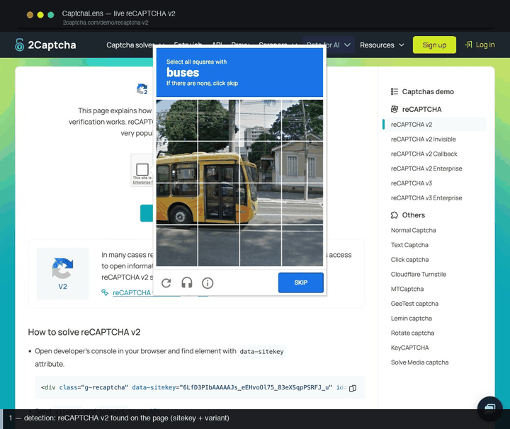

# CaptchaLens

> A Chrome extension that detects, identifies, and analyzes bot-detection challenges on any webpage — showing you exactly which system is present, where it lives in the DOM, and what triggered it.

[](https://developer.chrome.com/docs/extensions) [](LICENSE) [](CONTRIBUTING.md)

<p align="center">
  
</p>
<p align="center"><em>Live solve — real reCAPTCHA v2 demo, zero human input: detect → ensemble decisions → tile clicks → green checkbox → demo confirms the token.</em></p>

---

## Why This Exists

Every day humans waste millions of hours proving they're human. CaptchaLens gives developers, QA engineers, researchers, and privacy-conscious users **X-ray vision into bot-detection systems**:

- **Developers** — see which challenge provider a site uses before integrating your own
- **QA / Test engineers** — instantly know why your automation got flagged
- **Researchers** — study the distribution of anti-bot vendors across the web
- **Humans** — understand what you're being asked to do and why

CaptchaLens is a **detector and analyzer**, with an experimental AI decision layer (proof of concept) that judges visible challenges. It does not auto-bypass anything — it reveals, then informs.

---

## Current Capabilities

### Layer 1 — Detection (stable)

- Full-DOM scan on load + debounced `MutationObserver` for lazy-loaded challenges, traversing shadow roots
- Built-in handlers with evidence reporting: **reCAPTCHA v2** (checkbox vs. invisible), **reCAPTCHA v3** (sitekey + execute hook), **hCaptcha**, **Cloudflare Turnstile** (variant from `data-appearance`)
- Popup cards per detection: vendor, variant, sitekey, frame origin, evidence list; toolbar badge with live count
- Per-tab session storage of detections

### Layer 2 — Decision engine (proof of concept, live-verified)

Pipeline: popup **"Solve with Gemini"** → `captureVisibleTab` screenshot → service worker → **OpenRouter Decisions API** (`POST /api/alpha/decisions`) → typed structured answers rendered in popup.

- Model from `.env` (`OPENROUTER_API_KEY`, `OPENROUTER_MODEL`, injected at build time via esbuild `define`; currently `google/gemini-decision-1`)
- Question set: `challenge_type` (choice — image-grid / slider / rotation / press-hold / text / icon-click / checkbox / unknown), `solvable` (noul), `complexity` (score), `first_target` (box, with automatic fallback when the provider rejects it)
- Result card: per-question confidence bars, top-3 type probabilities, target-box coordinates, complexity readout, raw answers `<details>`
- Deterministic: same frame in → same distribution out; ~$0.00003–0.00015 per decision, ~1s latency

#### Benchmark (live, 2026-11-18)

| Test | gemini-decision-1 | jev-1.14 | winner |
|---|---|---|---|
| Tile ID, traffic grid (truth 1,3,5,6) | 4/4, margins 0.91–0.93 / 0.08–0.10 | 4/4, margins **0.98–0.99 / 0.01** | jev (sharper) |
| Per-tile cost / classification confidence | $0.000146 / 75.7% | **$0.000042 / 98.0%** | jev |
| Box localization | unsupported (400) | supported, weak on synthetic frames (self-reported 6% conf) | open |
| Odd-one-out (truth: tile 4) | 1/1 @ 0.89 | 1/1 @ **0.99** | jev (sharper) |
| hCaptcha-style "select all squares" | 3/3 @ 0.92–0.94 | 3/3 @ **0.99** | jev (sharper) |
| Audio input (`input_audio`) | **accepted** (judged tone `has_speech=0.327`) | rejected | gemini (only) |

**Routing conclusion:** jev-1.14 is the stronger vision decision engine (calibration, cost, box support); gemini-decision-1 is the only tested model that accepts audio. Planned: route by challenge type — jev for vision, gemini for audio captchas.

---

## The Landscape of Bot-Detection Challenges

### 1. Interaction-Based (Gesture Verification)

| Challenge | How It Works | Vendors / Sites |
|---|---|---|
| **Press & Hold** | Hold a button 3–10s; pressure, timing jitter, and pointer entropy are scored | Walmart, Shopify checkout (HUMAN / PerimeterX) |
| **Slide Puzzle** | Drag a puzzle piece into a notch; trajectory is analyzed, not just the endpoint | Geetest v3 |
| **Image Rotation** | Rotate an object upright via slider | Arkose Labs (FunCaptcha) — Microsoft, Roblox |
| **Multi-Step Puzzles** | Matching, "odd one out", 3D object challenges in sequence | Arkose Enforce |
| **Slider-to-Fit** | Drag a slider until two image halves align | Geetest, common on CN/JP sites |

### 2. The Google Family

| Type | Mechanism |
|---|---|
| **reCAPTCHA v2 checkbox** | "I'm not a robot" — risk-scored; frequently passes with no challenge |
| **reCAPTCHA v2 image grid** | "Select all traffic lights" — 3×3 / 4×4 tile selection |
| **reCAPTCHA v2 audio** | Spoken-digit transcription fallback (largely deprecated) |
| **reCAPTCHA v3** | Fully invisible; emits a 0.0–1.0 score per action |
| **reCAPTCHA Enterprise** | v3 + per-action ML scoring, account-based |

### 3. Third-Party CAPTCHA Providers

| Provider | Style |
|---|---|
| **hCaptcha** | Checkbox + image-grid challenges (Cloudflare's former default) |
| **Cloudflare Turnstile** | Managed / non-interactive / invisible — usually zero user effort |
| **Geetest v4** | Icon selection, space-themed click challenges |
| **Friendly Captcha** | Proof-of-work solved in the background |
| **ALTCHA** | Open-source proof-of-work |
| **Anubis / mCaptcha** | PoW gates aimed at AI crawlers |

### 4. Enterprise Bot Managers (Invisible until they escalate)

| Platform | Escalation Behavior |
|---|---|
| **Cloudflare Bot Management** | JS challenge → managed challenge → interactive Turnstile |
| **Akamai Bot Manager** | Silent sensor-data collection; Telemetry pixel |
| **DataDome** | Device fingerprinting; slider captcha fallback |
| **HUMAN / PerimeterX** | Press-and-hold and slider challenges |
| **Kasada** | Heavily obfuscated JS + proof-of-work; minimal DOM footprint |
| **Imperva / Shape (F5) / Radware** | Signal encryption, invisible scoring |

### 5. Detection Signals (What Actually Decides)

- **Browser fingerprint** — canvas, WebGL, audio, fonts, `navigator.webdriver`, CDP artifacts
- **Behavioral** — mouse-movement entropy, keystroke cadence, event-timing jitter
- **Network** — IP reputation, JA3/JA4 TLS fingerprints, HTTP/2 frame fingerprints
- **Attestation** — Private Access Tokens / device attestation (Apple, Chrome pilot)

---

## Architecture (Planned)

```
┌─────────────────────────────────────────────┐
│                 Chrome Extension            │
│                                             │
│  ┌───────────────┐      ┌────────────────┐  │
│  │ Content Script│─────▶│ Detector Engine│  │
│  │  (DOM scan)   │      │  (registry of  │  │
│  └───────────────┘      │   handlers)    │  │
│         │               └────────┬───────┘  │
│         │                       │           │
│  ┌──────▼────────┐      ┌───────▼────────┐  │
│  │ MutationObserver│    │ Popup / Badge  │  │
│  │ (dynamic loads)│     │ UI + DevTools  │  │
│  └───────────────┘      └────────────────┘  │
└─────────────────────────────────────────────┘
```

Each supported system gets a **handler** — a self-contained module implementing a common interface:

```ts
interface CaptchaHandler {
  id: string;                    // "recaptcha-v2"
  vendor: string;                // "Google"
  name: string;                  // "reCAPTCHA v2"
  detect(root: Document): Detection | null;   // DOM / script / frame signatures
  classify?(el: Element): Variant;            // checkbox vs. image grid, etc.
  report?(det: Detection): HandlerReport;     // metadata for the popup UI
}
```

---

## Project Structure

```
├── build.mjs                    # esbuild bundler; injects .env (OPENROUTER_API_KEY / OPENROUTER_MODEL) via define
├── .env                         # OpenRouter key + model (gitignored)
├── public/
│   ├── manifest.json            # Manifest V3 + host_permissions for openrouter.ai
│   ├── popup.html / popup.css   # popup shell + solve button / result card
├── fixtures/
│   └── fake-widgets.html        # offline stand-ins for scanner testing
└── src/
    ├── core/
    │   ├── types.ts             # CaptchaHandler, Detection, signatures
    │   ├── registry.ts          # handler registration + lookup
    │   ├── messages.ts          # typed runtime messages + SolveOutcome
    │   ├── solver.ts            # Decisions question set, typed answers, result composition
    │   └── dom.ts               # deep DOM traversal (shadow roots), script inventory
    ├── handlers/
    │   ├── recaptcha-v2.ts / recaptcha-v3.ts
    │   ├── turnstile.ts / hcaptcha.ts
    │   └── index.ts             # registerBuiltinHandlers()
    ├── content/
    │   ├── scanner.ts           # signature-matching engine
    │   ├── observer.ts          # debounced MutationObserver (lazy loads)
    │   └── main.ts              # content entry, reports to background
    ├── background/
    │   ├── gemini.ts            # OpenRouter Decisions client (box-fallback, answer normalization)
    │   └── service-worker.ts    # per-tab storage + badge + solve message handler
    └── ui/popup/
        └── popup.ts             # detection cards, solve flow (capture → solve → render)
```

## Development

```bash
npm install
npm run build        # or: npm run watch
```

Then `chrome://extensions` → Developer mode → **Load unpacked** → select `dist/`. Open `fixtures/fake-widgets.html` via a local server to see detections end-to-end without touching real vendor pages.

---

## Install as a User

1. Build the extension: `npm install && npm run build`
2. Open `chrome://extensions`, enable **Developer mode** (top right)
3. Click **Load unpacked** and select the `dist/` folder
4. Pin CaptchaLens from the puzzle-piece menu — the badge shows how many bot-detection systems the current tab exposes
5. Click the icon → **settings** (bottom right) → pick a provider, paste your key, save

### Configure the solver (providers & credentials)

Credentials live in `chrome.storage.sync` — they are yours, entered at runtime, never baked into the build. The build-time `.env` is only a fallback default for OpenRouter.

| Provider | Model (default) | Credential | Good for |
|---|---|---|---|
| **OpenRouter** *(recommended)* | `typesafe/jev-1.14` | OpenRouter key — [openrouter.ai/keys](https://openrouter.ai/keys) | All vision captchas; Decisions API, typed answers, ~$0.0001/judgment |
| **Google Gemini** | `gemini-flash-latest` | AI Studio key — [aistudio.google.com/apikey](https://aistudio.google.com/apikey) | Audio captchas; fallback vision via structured JSON |
| **Local** (OpenAI-compatible) | `qwen2.5vl` | none needed | Ollama / LM Studio / llama.cpp — zero cost, fully offline |

Defaults ship as **OpenRouter + `typesafe/jev-1.14`** — the sharpest calibration in our benchmark (see Current Capabilities). To switch models, edit the Model field in settings; every Decisions-API model on OpenRouter works (`google/gemini-decision-1`, `liquid/d1.2`, `cloudflare/clef-flash`, …).

### Benchmark at a glance

```
tile-ID margin (selected prob)      jev ██████████████████ 0.99    gemini ██████████████░░░ 0.93
tile-ID margin (rejected prob)      jev ░░ 0.01                    gemini ░░░░░░░░░░ 0.10   (lower = cleaner)
odd-one-out target prob             jev ███████████████████ 0.99   gemini █████████████████ 0.89
hCaptcha-style classification       jev ███████████████████ 0.98   gemini ██████████████░░░ 0.76
box localization (real photos)      jev █████████████░░░░ 0.74     gemini — unsupported
audio input                         jev — rejected                 gemini ████████████████ OK
cost per 16-tile judgment           jev ~$0.00013                  gemini ~$0.00026
```

---

### Layer 2.5 — Live end-to-end harness (real captchas, recorded)

`scripts/e2e-recaptcha.mjs` and `scripts/e2e-clickcaptcha.mjs` load the built extension into a headed Chromium (with video recording), seed credentials via URL params, then drive **real live captchas** through the same decision engine the extension uses:

| stage | what runs | proof |
|---|---|---|
| Detection | content script + handler registry on the live page | `reCAPTCHA v2 (Google) [recaptcha iframe; .g-recaptcha widget; response textarea; api.js script tag]`, sitekey + variant captured |
| Decision | OpenRouter Decisions API (jev-1.14 + gemini-decision-1 ensemble) | `challenge_type` 99.9–100%, target class read from example-thumbnail banners, per-tile noul grids |
| Action | tile/coordinate clicks computed from typed answers | real clicks inside Google's cross-origin iframe + ordered clickcaptcha sequences |
| Verdict | parsed from the live page | **green checkbox — reCAPTCHA accepted, token issued** (`recaptcha-solved.gif`) |

**Real solve achieved on the live reCAPTCHA v2 demo** — recorded on the challenge page itself (per-page video capture, not a context dump). The harness plays the full dynamic-challenge mechanics Google serves:

- **Banner-driven two-mode state machine** — the banner text is read every round: `"Select all images with a bus — Click verify once there are none left."` → **UPDATED mode** (selections kept, only unchecked tiles judged) vs no-banner/new-grid → **FRESH mode** (full re-judge, selections cleared)
- **"None left" honoring** — when both models score every unchecked tile below threshold, the harness clicks verify exactly as the banner instructs instead of re-clicking checked tiles (which would deselect them)
- **Stuck ladder** — if the state is unchanged after a verify: round 1 borderline rescue at ≥0.38, round 2 at ≥0.30, round 3 select-all-remaining (continuation rounds are predominantly target tiles), round 4 clean session restart — no infinite hangs
- **Ensemble + carry** — jev-1.14 and gemini-decision-1 judge every unchecked tile; union picks; class carried across rounds and re-read when the banner switches objects

Conditions that produced the solve, and what's still open:

1. **Stealth context** — patchright (playwright fork) meaningfully reduces Google's bot-flagging vs stock automated Chromium; stock contexts kept failing on risk scoring
2. **Ensemble decisions** — jev-1.14 + gemini-decision-1 union on every tile catches spanning objects a single model misses
3. **Span-aware instructions** — dynamic grids split one object across tiles; "even a small sliver counts" instructions fixed our recall
4. **Multi-round carry** — dynamic challenges continue after correct verification; the carried class must re-read when Google switches objects mid-challenge (worked: bicycle → car)
5. **Open gaps** — cross-session reliability (solve achieved on session 1 here, but Google's risk scoring varies run to run), crop-and-verify pixel refinement for point-validation captchas, and the demo sitekey's intermittent `exceeding reCAPTCHA free quota` degradation

### Cost & Time vs Solving Services

Per-solve cost and typical wall time for a reCAPTCHA v2 image challenge. Competitor figures are published list prices / reported medians (approximate, subject to change); CaptchaLens figures are measured from our live E2E sessions.

| Service | Price per solve | Typical time | How it works |
|---|---|---|---|
| 2captcha (human workers) | ~$0.0029 | 20–45s | human farms, API round-trip |
| Anti-Captcha (human workers) | ~$0.0020 | 15–35s | human farms, API round-trip |
| CapSolver (AI service) | ~$0.0008 | 5–15s | cloud AI, API round-trip + account |
| **CaptchaLens (local plugin)** | **~$0.0003–0.0015** | **10–60s** | in-browser decisions API, no account, no API round-trip |

```
price per solve (log-ish scale)          time per solve
2captcha      ████████████████████ $0.0029   2captcha      ████████████████████ 20–45s
Anti-Captcha  █████████████ $0.0020            Anti-Captcha  ██████████████ 15–35s
CapSolver     █████ $0.0008                   CapSolver     ███████ 5–15s
CaptchaLens   ██ $0.0003–0.0015               CaptchaLens   ██████████████████ 10–60s
```

Where CaptchaLens wins: **cost** (3–10× cheaper than human farms, same order as CapSolver with zero account setup), **privacy** (screenshots go only to the LLM provider you configure — a local model means nothing leaves the machine), **transparency** (every decision is a typed answer with calibrated confidence you can inspect). Where services still win: **consistency** — human farms solve near-100% regardless of risk scoring; Google's risk engine flags automated browsers no matter how good the answers are, so CaptchaLens solve rates depend on the stealth quality of the browser context.

---

## Automated Browsers (Playwright / Puppeteer / stealth)

CaptchaLens is Manifest V3 Chromium — it loads in any Chromium automation context. (Camoufox is Firefox-based: MV3 extensions do not run there without a WebExtensions port; use Chromium stealth forks like **patchright** or puppeteer-extra-stealth instead.)

### Playwright / patchright

```ts
import { chromium } from "playwright"; // or "patchright" for stealth
import { chromium as pw } from "playwright-core";

const extPath = "/absolute/path/to/captchalens/dist";
const ctx = await chromium.launchPersistentContext("", {
  headless: false, // extensions require headed mode in Chromium
  args: [
    `--disable-extensions-except=${extPath}`,
    `--load-extension=${extPath}`,
  ],
});

// find the extension ID from its service worker
let [sw] = ctx.serviceWorkers();
if (!sw) sw = await ctx.waitForEvent("serviceworker");
const extId = sw.url().match(/chrome-extension:\/\/([^/]+)/)![1];

// seed credentials with code — options.html saves URL params on load
const page = await ctx.newPage();
await page.goto(
  `chrome-extension://${extId}/options.html` +
    `?provider=openrouter&key=sk-or-v1-YOUR-KEY&model=typesafe/jev-1.14`
);

// solve the current tab: open the popup as a page and click the button
const popup = await ctx.newPage();
await popup.goto(`chrome-extension://${extId}/popup.html`);
await popup.click("#solve");
await popup.waitForSelector(".solve-result .card", { timeout: 60000 });
const verdict = await popup.textContent(".solve-result");
console.log(verdict);
```

### Puppeteer

```js
import puppeteer from "puppeteer";

const extPath = "/absolute/path/to/captchalens/dist";
const browser = await puppeteer.launch({
  headless: false, // new headless (chrome --headless=new) supports extensions
  args: [
    `--disable-extensions-except=${extPath}`,
    `--load-extension=${extPath}`,
  ],
});
const page = await browser.newPage();
// extension id is visible at chrome://extensions — or read it via the service worker target
const targets = browser.targets();
const sw = targets.find((t) => t.type() === "service_worker" && t.url().includes("chrome-extension://"));
const extId = new URL(sw.url()).host;
await page.goto(`chrome-extension://${extId}/options.html?provider=openrouter&key=sk-or-v1-…&model=typesafe/jev-1.14`);
```

### Selecting values with code (no UI)

The options page accepts URL params and saves them on load:

```
options.html?provider=openrouter|gemini|local
            &key=YOUR_KEY
            &model=typesafe/jev-1.14
            &baseUrl=http://localhost:11434/v1   (local only)
```

Equivalent direct storage write from an extension context (service worker / popup console):

```js
await chrome.storage.sync.set({
  solverSettings: {
    provider: "openrouter",
    apiKey: "sk-or-v1-…",
    model: "typesafe/jev-1.14",
    baseUrl: "http://localhost:11434/v1",
  },
});
```

### Metrics from automation

Every solve writes a structured card to `.solve-result` — scrape `.confidence`, `.vendor`/challenge type chip, and the `raw answers` `<details>` JSON for your own metric collection. The `solve` runtime message also returns the full `SolveOutcome` object if you drive the service worker directly.

---

## Roadmap / TODO

### Phase 0 — Foundation
- [x] Scaffold Chrome extension (Manifest V3, TypeScript, esbuild)
- [x] Detector engine with handler registry
- [x] Content script: full-DOM scan + `MutationObserver` for lazy-loaded challenges
- [x] Popup UI: list detections on the current tab
- [x] Toolbar badge showing number of detected systems
- [ ] CI: lint, typecheck, build, and package (zip) workflow

### Phase 1 — The Big Three
- [x] **Handler: reCAPTCHA v2** — `iframe[src*="google.com/recaptcha"]`, `.g-recaptcha`, `#g-recaptcha-response`; classify checkbox vs. invisible
- [x] **Handler: hCaptcha** — `iframe[src*="hcaptcha.com"]`, `.h-captcha`, `#h-captcha-response`
- [x] **Handler: Cloudflare Turnstile** — `.cf-turnstile`, `iframe[src*="challenges.cloudflare.com"]`; variant from `data-appearance`
- [x] **Handler: reCAPTCHA v3** — `grecaptcha.execute` hooking, `data-sitekey` + invisible widget detection

### Phase 2 — Interactive & Puzzle Challenges
- [ ] **Handler: Arkose Labs (FunCaptcha)** — `iframe[src*="arkoselabs.com" / "funcaptcha.com"]`, `#funcaptcha`, `data-callback` presence
- [ ] **Handler: Geetest v3/v4** — `.geetest_holder`, `initGeetest` script signature; classify slide vs. icon vs. space variants
- [ ] **Handler: Press & Hold (HUMAN/PerimeterX)** — `iframe[src*="px-cdn.net" / "perimeterx.net"]`, `#px-captcha` hold-button detection
- [ ] **Handler: DataDome** — `iframe[src*="datadome.co"]`, `geo.captcha-delivery.com` script signature, slider challenge
- [ ] **Handler: Friendly Captcha** — `.frc-captcha`, proof-of-work worker detection
- [ ] **Handler: ALTCHA** — `altcha-widget` custom element
- [ ] **Handler: Anubis** — anubis-style PoW interstitial page detection
- [ ] **Handler: mCaptcha** — `__mcaptcha__` global / widget element

### Phase 3 — Enterprise Bot Managers (Invisible Layer)
- [ ] **Handler: Cloudflare Bot Management** — challenge-platform interstitial page (`#challenge-running`, `Just a moment...`)
- [ ] **Handler: Akamai Bot Manager** — `_sec_` cookies, `px`/Akamai sensor script signatures, Telemetry pixel
- [ ] **Handler: Kasada** — obfuscated script entry-point detection (heuristic, minimal DOM footprint)
- [ ] **Handler: Imperva** — `incapsula` / `_incap_` cookie + script fingerprints
- [ ] **Handler: Shape / F5** — encrypted signal beacon detection
- [ ] **Handler: Radware** — bot-manager script fingerprints
- [ ] **Handler: Queue-it / virtual waiting rooms** — waiting-room interstitial detection (adjacent, useful signal)

### Phase 3.5 — Decision Engine (new, proof of concept)
- [x] **Decisions API integration** — screenshot → OpenRouter `/api/alpha/decisions` → typed answers (`choice` / `noul` / `score`, `box` fallback)
- [x] **Popup solve flow** — captureVisibleTab → solve → structured result card (confidence bars, probabilities, raw answers)
- [x] **Env-configurable model** — `.env` injected at build time; runtime settings override (provider + key + model per user)
- [x] **Provider flexibility** — OpenRouter / Gemini direct / local OpenAI-compatible, credentials in `chrome.storage.sync`
- [x] **Model benchmark** — gemini vs. jev across tile ID, odd-one-out, hCaptcha-style shapes, box, audio (see Current Capabilities); **jev-1.14 default**
- [x] **Per-tile identification** — stage-2 per-cell `noul` requests (4/4 on synthetic, 4/4 on real 4×4 grid)
- [x] **Live E2E harness** — real reCAPTCHA v2 + 2captcha ClickCaptcha, recorded (`scripts/e2e-*.mjs`, GIFs above)
- [x] **Green solve on live reCAPTCHA v2** — 4-round dynamic challenge solved end-to-end (patchright stealth + jev/gemini ensemble + span-aware tiles + multi-round carry) — see `recaptcha-solved.gif`
- [ ] **Crop-and-verify refinement** — pixel-precise localization for point-validation captchas (ClickCaptcha exact-point validation still fails)
- [ ] **Example-thumbnail class matching** — multi-image decisions state for dynamic re-rounds
- [ ] **Model routing** — jev-1.14 primary for vision, gemini-decision-1 for audio captchas
- [ ] **Cross-session solve reliability** — green solve achieved on session 1; Google risk scoring varies run to run, needs success-rate measurement

### Phase 4 — Analysis & Insights
- [ ] Per-detection detail panel: vendor, variant, iframe origin, sitekey, triggered-at timestamp
- [ ] Legacy captchas: distorted-text, math questions, honeypot-field heuristics
- [ ] Signal visibility: show which fingerprints the page probes (canvas, WebGL, audio, `navigator.webdriver`)
- [ ] Export current-tab report as JSON
- [ ] Optional aggregate research mode (opt-in, local-only stats)
- [ ] Options page: toggle handlers, dark mode, badge preferences

### Phase 5 — Polish & Release
- [ ] Comprehensive test suite (unit + fixture pages per handler)
- [ ] Screenshot assets and Chrome Web Store listing copy
- [ ] Documentation: writing your own handler (community contributions)
- [ ] Firefox (WebExtensions) port evaluation

---

## Contributing

Handlers are intentionally small and isolated — adding support for a new system is a great first PR. See the roadmap above for unclaimed handlers.

## License

MIT — see [LICENSE](LICENSE).
